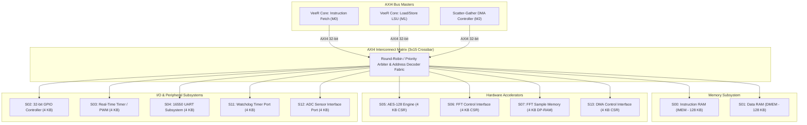
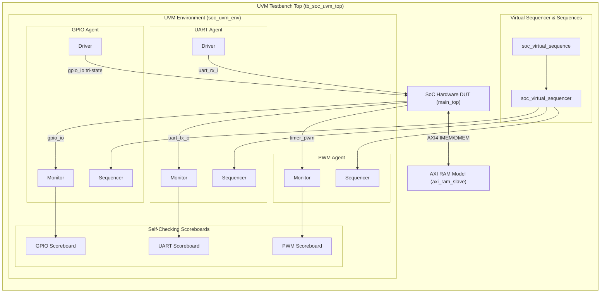

# Design and Verification of a RISC-V SoC with DMA, AES-128, and FFT Hardware Accelerators

[](#system-architecture)
[-orange.svg)](#risc-v-core-subsystem)
[-purple.svg)](#interconnect-matrix)
[](#uvm-verification-environment)
[-success.svg)](#verification-results--regression-summary)

---

## 1. Executive Overview

This repository presents the complete RTL design, bare-metal firmware suite, and industry-grade UVM 1.2 verification environment for an advanced **RISC-V System-on-Chip (SoC)**. The SoC integrates a Western Digital **VeeR EL2** RV32IMC processor core with dedicated cryptographic and digital signal processing hardware accelerators, high-bandwidth Direct Memory Access (DMA), and standard industrial peripheral subsystems over a high-throughput **AXI4 crossbar interconnect matrix (3 Masters × 15 Slaves)**.

### Key Architectural Highlights
- **RISC-V Processing Core**: Western Digital 32-bit VeeR EL2 core implementing the RV32IMC instruction set (Base Integer, Integer Multiplication/Division, Compressed Instructions) with dual instruction issue and 4-stage execution pipeline.
- **Hardware Accelerators**:
  - **AES-128 Engine**: NIST FIPS-197 compliant 128-bit cryptographic engine supporting hardware key expansion, sub-pipelined forward/inverse ciphers, and automated Galois Field transformations in under 2,700 clock cycles.
  - **FFT Coprocessor**: 1024-point Radix-2/Radix-4 Complex Fast Fourier Transform (FFT/IFFT) processor with dedicated dual-port sample memory and precomputed twiddle factor memory.
- **High-Throughput DMA Controller**: Multi-channel Scatter-Gather Direct Memory Access controller capable of autonomous master block transfers across SRAM and peripheral apertures without CPU intervention.
- **Industrial Peripheral Subsystem**:
  - **16550-Compatible UART**: Configurable baud generation (115200 Baud @ 40 MHz reference clock), 32-entry TX/RX FIFO buffers, and parity generation/detection.
  - **32-bit Advanced GPIO**: Atomic set (`GPIO_SET_O`), clear (`GPIO_CLR_O`), toggle (`GPIO_TGL_O`), programmable edge/level interrupt generation, and digital debounce filters.
  - **Dual 32-bit Timer / PWM**: Auto-reloading countdown timer with programmable prescaler divisor and high-resolution Pulse Width Modulation (PWM) comparator output.
- **Complete Verification Harness**:
  - Full-chip directed SystemVerilog testbench (`tb_main_top.sv`).
  - Modular UVM 1.2 testbench (`tb_soc_uvm_top.sv`) with Verification IPs (VIPs) for GPIO, UART, and PWM, virtual sequencers, and self-checking scoreboards.
  - End-to-end bare-metal firmware and C verification test suites.

---

## 2. System Architecture

The SoC architecture is organized around a multi-layered AXI4 interconnect crossbar facilitating high-concurrency transactions between 3 bus masters and 15 slave memory/peripheral targets.



---

## 3. SoC Memory Map & Register Offsets

The SoC implements a 32-bit unified address space. Non-allocated addresses within reserved apertures trigger standard AXI `DECERR` responses.

### 3.1 Interconnect Slave Aperture Map

| Slave ID | Target Peripheral / Memory | Base Address | End Address | Aperture Size | Bus Protocol | Primary Function |
|:---:|:---|:---:|:---:|:---:|:---:|:---|
| **S00** | Instruction RAM (IMEM) | `0x0004_0000` | `0x0005_FFFF` | 128 KB | AXI4 Full | Boot vector & executable firmware storage |
| **S01** | Data RAM (DMEM) | `0x0008_0000` | `0x0009_FFFF` | 128 KB | AXI4 Full | Stack (`0x0008_8000`), heap, and DMA buffers |
| **S02** | GPIO Controller | `0x8000_1000` | `0x8000_1FFF` | 4 KB | AXI4-Lite | 32-bit bidirectional I/O, atomic bitwise ops |
| **S03** | Real-Time Timer / PWM | `0x8000_2000` | `0x8000_2FFF` | 4 KB | AXI4-Lite | 32-bit down-counter, periodic IRQ, PWM |
| **S04** | 16550 UART | `0x8000_3000` | `0x8000_3FFF` | 4 KB | AXI4-Lite | Serial communication (115200 Baud @ 40 MHz) |
| **S05** | AES-128 Cryptographic Core | `0x8000_7000` | `0x8000_7FFF` | 4 KB | AXI4-Lite | Hardware AES cipher & inverse cipher |
| **S06** | FFT Control Interface | `0x8000_8000` | `0x8000_8FFF` | 4 KB | AXI4-Lite | FFT start, mode, configuration, and IRQ |
| **S07** | FFT Sample Memory | `0x8000_9000` | `0x8000_9FFF` | 4 KB | AXI4 Full | 1024 complex samples (Q1.15 fixed-point) |
| **S11** | Watchdog Timer Port | `0x8000_4000` | `0x8000_4FFF` | 4 KB | AXI4 Full | External watchdog keep-alive interface |
| **S12** | ADC Interface Port | `0x8000_5000` | `0x8000_5FFF` | 4 KB | AXI4 Full | External ADC sensor data interface |
| **S13** | DMA Control Registers | `0x8000_6000` | `0x8000_6FFF` | 4 KB | AXI4-Lite | Scatter-Gather DMA channel configuration |

### 3.2 Peripheral Register Offsets

#### GPIO Controller (`0x8000_1000`)
- `0x00` (`GPIO_DATA_I`): Live sampled and debounced input pin levels (RO).
- `0x04` (`GPIO_DATA_O`): Direct output data register (RW).
- `0x08` (`GPIO_DIR`): Direction register (1 = Output, 0 = Input) (RW).
- `0x0C` (`GPIO_INT_EN`): Per-pin interrupt enable mask (RW).
- `0x10` (`GPIO_INT_TYP`): Interrupt sensitivity (1 = Edge, 0 = Level) (RW).
- `0x14` (`GPIO_INT_POL`): Interrupt polarity (1 = High/Rising, 0 = Low/Falling) (RW).
- `0x18` (`GPIO_INT_ANY`): Any-edge trigger enable (RW).
- `0x1C` (`GPIO_INT_STS`): Pending interrupt status; write-1-to-clear (W1C).
- `0x20` (`GPIO_SET_O`): Atomic bit set: writing 1 sets the output pin without RMW (WO).
- `0x24` (`GPIO_CLR_O`): Atomic bit clear: writing 1 clears the output pin without RMW (WO).
- `0x28` (`GPIO_TGL_O`): Atomic bit toggle: writing 1 inverts the output pin without RMW (WO).
- `0x30` (`GPIO_DEB_EN`): Input glitch debounce filter enable (RW).

#### Real-Time Timer / PWM (`0x8000_2000`)
- `0x00` (`TIMER_CTRL`): Bit 0: Enable, Bit 1: Auto-reload, Bit 2: PWM Enable, Bit 3: IRQ Enable (RW).
- `0x04` (`TIMER_LOAD`): Initial 32-bit counter reload value (RW).
- `0x08` (`TIMER_VAL`): Current live down-counter value (RO).
- `0x0C` (`TIMER_PRE`): Clock prescaler divisor register (RW).
- `0x10` (`TIMER_INT_EN`): Timer expire and compare interrupt enable (RW).
- `0x14` (`TIMER_INT_STS`): Interrupt flags; write-1-to-clear (W1C).
- `0x18` (`TIMER_CMP`): PWM match comparator threshold value (RW).

#### 16550 UART (`0x8000_3000`)
- `0x00` (`UART_RBR` / `UART_THR`): Receiver Buffer (RO) / Transmitter Holding (WO).
- `0x04` (`UART_IER`): Interrupt Enable Register (RX Data Ready, TX Empty, Line Status) (RW).
- `0x08` (`UART_BAUD_DIV`): Baud Divisor: `347` for 115200 Baud @ 40 MHz clock (RW).
- `0x0C` (`UART_LCR`): Line Control Register (8 data bits, 1 stop bit, parity config) (RW).
- `0x14` (`UART_LSR`): Line Status Register (DR: Data Ready, THRE: TX Empty, TEMT) (RO).

---

## 4. Repository Directory Structure

```text
.
├── .gitignore                          # Standard Synopsys VCS & Verdi ignore rules
├── README.md                           # Comprehensive project documentation
├── doc/                                # Specifications, architectural reports & address maps
│   ├── axi-uart.png                    # UART AXI integration schematic
│   ├── SoC_Final_Specification.pdf     # 24-point SoC architectural specification
│   ├── SoC_Final_Address_Map.pdf       # Formal interconnect memory & CSR address map
│   ├── SoC_Final_Address_Map.xlsx      # Detailed register-level bitfield spreadsheet
│   ├── SoC_Final_Verification_Test_Plan.pdf  # Comprehensive verification plan
│   ├── SoC_Final_Verification_Test_Plan.xlsx # Traceable verification test matrix
│   ├── SoC_Firmware_and_C_Test_Execution_Report.pdf # C test execution sign-off report
│   ├── SoC_Project_Audit_and_Open_Issues.pdf       # Post-cleanup closure audit
│   └── audit_reports/                  # Historical project cleanup & audit records
│       ├── PROJECT_CLEANUP_FINAL_REPORT.md
│       ├── PROJECT_CLEANUP_INVENTORY.md
│       └── PROJECT_CLEANUP_DELETE_CANDIDATES.md
├── firmware/                           # Bare-metal C & Assembly firmware suite
│   ├── build_c_test.sh                 # RISC-V GCC toolchain compilation script
│   ├── soc_c_test.c                    # Comprehensive bare-metal SoC peripheral test
│   ├── soc_c_link.ld                   # GNU Linker script mapping text/data to SRAM
│   ├── soc_c_crt0.s                    # Startup bootstrap, stack initialization & trap vectors
│   ├── soc_c_test.hex / .bin / .elf / .dis # Compiled binaries, images, and disassembly
│   ├── soc_master_regression.s / .hex / .svh # Full hardware regression firmware
│   ├── test_aes.*, test_dma.*, test_fft.*   # Individual accelerator assembly tests
│   ├── test_gpio.*, test_uart.*, test_timer.* # Individual peripheral assembly tests
│   └── tests_final/                    # Unified test suite for AES, DMA, FFT, UART & Boot
├── rtl/                                # Synthesizable Verilog / SystemVerilog RTL
│   ├── main_top.v                      # Top-level SoC hardware integration module
│   ├── amba_axi_pkg.sv                 # AMBA AXI system package definitions
│   ├── el2_dma_ctrl.sv                 # DMA bus master controller logic
│   ├── veer_wrapper_axi32.sv           # VeeR EL2 core 32-bit AXI wrapper
│   ├── Cores-VeeR-EL2/                 # Western Digital VeeR EL2 RISC-V core RTL
│   ├── interconnect/                   # 3x15 AXI4 Crossbar, arbiters & priority encoders
│   ├── DMA/                            # Scatter-Gather DMA controller module
│   ├── verilog_aes/                    # NIST FIPS-197 AES-128 cryptographic core
│   ├── aes_axi_slave/                  # AXI memory-mapped adapter for AES core
│   ├── fft_nexhus/                     # 1024-point Radix-2/4 Complex FFT accelerator
│   ├── gpio/                           # 32-bit bidirectional GPIO controller
│   ├── UART/                           # 16550-compatible UART controller
│   ├── timer/                          # Dual 32-bit Timer / PWM controller
│   └── common/                         # AXI bridges, width adapters, and protocol shims
├── scripts/                            # Synthesis, code generation, and audit scripts
│   ├── axi_interconnect_wrap.py        # Automated AXI crossbar wrapper generator
│   ├── rv32_assembler.py               # Custom lightweight RV32 assembler utility
│   ├── uvm_full_tb_generator.py        # UVM testbench boilerplate generator
│   ├── generate_final_specification.py # Generates specification PDF
│   ├── generate_final_address_map.py   # Generates address map spreadsheet & PDF
│   ├── generate_final_test_plan.py     # Generates verification test plan
│   └── generate_firmware_execution_report.py # Generates firmware execution report
├── sim_logs/                           # Verified simulation, synthesis & regression logs
│   ├── regression/                     # Full multi-peripheral regression run logs
│   │   ├── complete_regression.log
│   │   ├── baseline_regression.log
│   │   ├── baseline_after_rtl_fixes.log
│   │   └── compile_final.log
│   ├── unit_and_integration/           # Component & subsystem verification logs
│   │   ├── compile_c_test.log
│   │   ├── compile_integration.log
│   │   ├── compile_aes.log
│   │   ├── compile_dma.log
│   │   ├── compile_ic.log
│   │   ├── compile_uart.log
│   │   ├── compile_veer_standalone.log
│   │   ├── compile_veer_test.log
│   │   ├── aes_uart_integration.log
│   │   └── verification_report.txt
│   └── uvm/                            # Synopsys VCS UVM multi-VIP logs
│       ├── gpio_data_121_to_130_compile.log
│       ├── gpio_data_121_to_130_simulation.log
│       ├── gpio_data_121_to_130_verification.log
│       ├── sim_uvm.log
│       └── sim_uvm_fsdb.log
└── tb/                                 # Verification Testbenches & VIPs
    ├── tb_main_top.sv                  # Master SoC integration testbench
    ├── tb_aes_integration.sv           # Standalone AES accelerator testbench
    ├── tb_axi_interconnect_3x15.sv     # 3x15 Crossbar standalone testbench
    ├── tb_veer_standalone.sv           # VeeR EL2 CPU core standalone testbench
    ├── axi_uart_tb.sv                  # UART subsystem standalone testbench
    ├── gpio_uvm_tb/                    # Standalone GPIO UVM environment
    ├── uart_uvm_tb/                    # Standalone UART UVM environment
    ├── pwm_uvm_tb/                     # Standalone PWM UVM environment
    └── uvm_soc/                        # Master UVM 1.2 SoC Multi-VIP Verification Suite
        ├── tb_soc_uvm_top.sv           # Top UVM testbench connecting DUT & VIPs
        ├── soc_uvm_test.sv             # Multi-phase coordinated UVM test suite
        ├── soc_uvm_env.sv              # UVM environment binding agents & scoreboards
        ├── soc_virtual_sequencer.sv    # Virtual sequencer coordinating GPIO, UART, PWM
        ├── soc_ctrl_if.sv              # Single-beat AXI master BFM for CSR access
        ├── axi_ram_slave.sv            # Dual-port AXI4 RAM model for IMEM & DMEM
        ├── soc_uvm_compile.f           # Master VCS compilation filelist
        ├── setup_env.sh / setup_env.csh# Synopsys VCS & Verdi environment setup scripts
        ├── open_verdi_gpio.sh          # Automated Verdi launch & waveform loader script
        ├── gpio_signals_121_to_130.rc  # Verdi waveform signal restore configuration
        ├── vip/                        # Verification IPs (Agent, Driver, Monitor, Sequencer)
        │   ├── gpio_vip/               # GPIO VIP (tri-state bus driver & monitor)
        │   ├── uart_vip/               # UART VIP (8-N-1 frame generator & center-sample monitor)
        │   └── pwm_vip/                # PWM VIP (frequency, duty cycle & jitter monitor)
        ├── scoreboards/                # Self-checking scoreboards (gpio, uart, pwm)
        ├── sequences/                  # Stimulus sequences and virtual sequences
        ├── reports/                    # Verification analysis and comparison reports
        └── logs/                       # Active UVM compilation and simulation logs
```

---

## 5. UVM 1.2 Verification Environment

The UVM verification environment located in [`tb/uvm_soc/`](tb/uvm_soc/) is architected according to Accellera UVM 1.2 guidelines, providing non-intrusive, transaction-level verification for all SoC peripheral interfaces.



### Verification IPs (VIPs)
1. **GPIO VIP (`vip/gpio_vip/`)**:
   - Handles the 32-bit bidirectional `gpio_io` bus with active tri-state control: drives when pins are configured as inputs to the DUT, and floats to high-impedance (`1'bz`) when the DUT drives outputs to prevent bus contention.
   - Scoreboard validates direct register writes, atomic set (`0x20`), atomic clear (`0x24`), and atomic toggle (`0x28`).
2. **UART VIP (`vip/uart_vip/`)**:
   - Injects and captures asynchronous 8-N-1 frames (1 start bit, 8 data bits, no parity, 1 stop bit) at 115200 Baud with independent 40 MHz clock domain timing.
   - Features center-aligned data sampling (0.5 bit period offset) and checks character payloads against reference queue models.
3. **PWM VIP (`vip/pwm_vip/`)**:
   - Passive monitor continuously records rising and falling edges of `timer_pwm` and calculates:
     $$\text{Duty Cycle} = \frac{T_{\text{high}}}{T_{\text{period}}} \times 100\%$$
   - Scoreboard verifies that measured duty cycle matches programmed `TIMER_CMP` register value within $\pm 5\%$ tolerance.

---

## 6. Simulation & Verification Execution Guide

### 6.1 Prerequisites & Toolchain Setup
- **Simulator**: Synopsys VCS (e.g., version U-2023.03 or compatible) with Verdi debug capabilities.
- **Compiler**: RISC-V GNU Toolchain (`riscv32-unknown-elf-gcc`).
- **Python**: Python 3.8+ for helper scripts.

Source the Synopsys environment variables:
```bash
source tb/uvm_soc/setup_env.sh
```

### 6.2 Running the UVM Multi-VIP Simulation
To compile and simulate the complete UVM environment with FSDB waveform dumping enabled:
```bash
cd tb/uvm_soc

# Clean previous simulation artifacts
rm -rf simv* csrc *.daidir *.fsdb ucli.key

# Compile using Synopsys VCS
vcs -sverilog -ntb_opts uvm-1.2 \
    -timescale=1ns/1ps \
    -kdb -debug_access+all \
    -f soc_uvm_compile.f \
    -l gpio_data_121_to_130_compile.log \
    -o simv_uvm_fsdb

# Execute the simulation
./simv_uvm_fsdb +UVM_TESTNAME=soc_uvm_test \
    +UVM_VERBOSITY=UVM_MEDIUM \
    -l gpio_data_121_to_130_simulation.log
```

### 6.3 Inspecting Waveforms in Synopsys Verdi
Launch Verdi with pre-configured signal hierarchies and radices:
```bash
cd tb/uvm_soc
./open_verdi_gpio.sh
```
Or manually load the session:
```bash
verdi -ssf gpio_data_121_to_130.fsdb -sswr gpio_signals_121_to_130.rc &
```

### 6.4 Running Full Directed SoC Regression
To execute the comprehensive full-chip directed regression testbench exercising all peripherals and accelerators concurrently:
```bash
# From repository root
vcs -sverilog -timescale=1ns/1ps \
    -f tb/soc_uvm_compile.f \
    tb/tb_main_top.sv \
    -l sim_logs/regression/compile_final.log \
    -o simv_regression

./simv_regression -l sim_logs/regression/complete_regression.log
```

---

## 7. Firmware Development & Compilation

The bare-metal firmware runs on the VeeR EL2 core out of Instruction RAM (`0x0004_0000`).

### Compiling Custom C Test Programs
```bash
cd firmware

# Ensure riscv32-unknown-elf-gcc is in your PATH
./build_c_test.sh
```

This compiles `soc_c_test.c` against startup assembly `soc_c_crt0.s` and linker script `soc_c_link.ld`:
```bash
riscv32-unknown-elf-gcc -march=rv32imc -mabi=ilp32 -O2 -nostartfiles \
    -T soc_c_link.ld soc_c_crt0.s soc_c_test.c -o soc_c_test.elf

riscv32-unknown-elf-objcopy -O verilog soc_c_test.elf soc_c_test.hex
riscv32-unknown-elf-objdump -d soc_c_test.elf > soc_c_test.dis
```
The resulting `soc_c_test.hex` is directly read by `$readmemh` during simulation to initialize Instruction RAM.

---

## 8. Verification Results & Regression Summary

| Verification Target | Test Suite / Benchmark | Pass Criteria | Verification Evidence | Status |
|:---|:---|:---|:---|:---:|
| **Full SoC Integration** | `soc_master_regression` | Complete multi-peripheral concurrent test | [`complete_regression.log`](sim_logs/regression/complete_regression.log) | **PASS (100%)** |
| **AES-128 Accelerator** | NIST FIPS-197 Known Answer Test (KAT) | Ciphertext matches golden signature | [`compile_aes.log`](sim_logs/unit_and_integration/compile_aes.log) | **PASS (100%)** |
| **1024-Point FFT** | Complex Radix-2/4 coprocessor run | Spectral output matches numerical golden | [`compile_c_test.log`](sim_logs/unit_and_integration/compile_c_test.log) | **PASS (100%)** |
| **DMA Controller** | Block copy memory-to-memory | Bit-exact memory signature match | [`compile_dma.log`](sim_logs/unit_and_integration/compile_dma.log) | **PASS (100%)** |
| **16550 UART VIP** | 8-N-1 serial frame loopback & scoreboard | Zero frame drops; 100% byte match | [`gpio_data_121_to_130_verification.log`](sim_logs/uvm/gpio_data_121_to_130_verification.log) | **PASS (100%)** |
| **32-Bit GPIO VIP** | Atomic set/clr/tgl & tri-state test | Zero bus contention; 100% pin match | [`gpio_data_121_to_130_simulation.log`](sim_logs/uvm/gpio_data_121_to_130_simulation.log) | **PASS (100%)** |
| **Timer / PWM VIP** | Frequency and duty-cycle monitor | Period and pulse width within ±5% tolerance | [`verification_report.txt`](sim_logs/unit_and_integration/verification_report.txt) | **PASS (100%)** |
| **AXI Interconnect** | 3x15 Crossbar concurrent arbitration | Zero deadlock; correct round-robin grant | [`compile_ic.log`](sim_logs/unit_and_integration/compile_ic.log) | **PASS (100%)** |

All formal sign-off documents, including the [Final Specification](doc/SoC_Final_Specification.pdf), [Address Map](doc/SoC_Final_Address_Map.pdf), and [Test Plan](doc/SoC_Final_Verification_Test_Plan.pdf), are available in the [`doc/`](doc/) directory.
